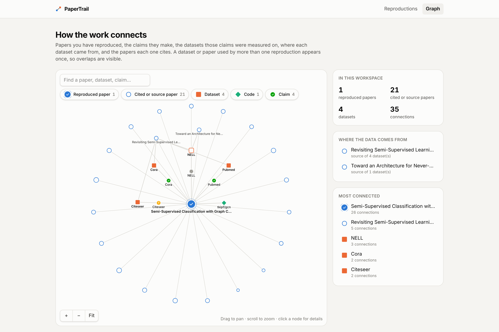

# PaperTrail

A workspace for turning a published computational result into a traceable reproduction: the claims the paper makes, the code, data and environment used to test them, the runs, the deviations, and what matched.

Status: pre-MVP. No application code yet. The repository currently holds the feasibility assessment and one completed pilot reproduction that the data model and first screens will be built against.

- [Feasibility assessment](docs/feasibility-assessment.md): verdict, corrections to the original brief, MVP scope, and who does what next.
- [Pilot reproduction: Kipf & Welling, GCN (ICLR 2017)](pilot/gcn-kipf-welling-2017/README.md): the official code run 100 times per dataset, compared with the paper's Table 2, with every deviation recorded.

## Running it locally




With Docker installed, one command starts everything (PostgreSQL, the API, the web app) and loads the GCN pilot:

```bash
docker compose up --build
```

Open http://localhost:3000. The API is also on http://localhost:8000.

The pilot project's token, needed to edit it, is printed once by the seed step:

```bash
docker compose logs seed
```

Stop with Ctrl+C. Data is kept in a Docker volume between runs. To delete it as well:

```bash
docker compose down -v
```

### Without Docker

Backend (Python 3.11+), using SQLite by default:

```bash
cd backend && pip install -e ".[dev]" && uvicorn papertrail_api.main:app --port 8000
```

```bash
cd backend && python scripts/seed_pilot.py --api http://localhost:8000
```

Web app (Node 20+):

```bash
cd web && npm install && npm run dev
```

### Recording runs

On the machine where the research code runs (Python 3.7+, no dependencies):

```bash
pip install ./sdk && papertrail run --run-set cora --seed 0 --metric 'acc=accuracy= ([0-9.]+)' -- python train.py
```

### Tests

```bash
cd backend && pytest -q
```

```bash
cd sdk && pytest -q
```
